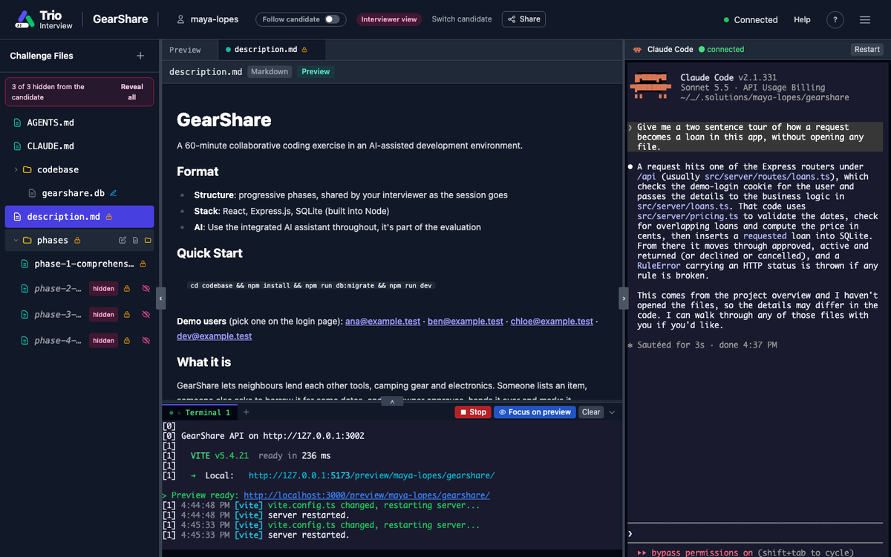

# Contributing

Thank you for wanting to help. There are two ways in, and the first needs no code: you can add an exercise, or you can change the tool itself. Small pull requests that do one thing are the easiest to review, so start there.

## Set up

```bash
nvm use           # Node 25, see .nvmrc
make install      # installs dependencies and checks Claude Code, OpenCode and the tunnel
make help         # every command
```

`make dev` starts the frontend and the backend with hot reload, `make test` runs the unit tests and `make typecheck` the type check. [AGENTS.md](AGENTS.md) explains how the tool is put together, and it is the file to give any AI agent that works on this repository.

## Send a change


1. Fork the repository and branch from `main` with a short name (`feature/`, `fix/` or `chore/` followed by what it does). Nobody pushes to `main` directly.
2. Make the change with a test. Logic goes in small functions that are easy to test, and the files that need a real process, terminal, socket or assistant stay thin.
3. Run `npm run lint`, `make typecheck`, `make test` and `npx next build`. The pull request runs the same checks.
4. If you changed something people see, try it in the browser on both sides: `http://localhost:3000` is the interviewer, and `http://candidate.localhost:3000` (or the tunnel link in another browser profile) is the candidate.
5. Open the pull request and say what changed and how you checked it. A screenshot helps for anything visual.

## Add an exercise

Exercises you use live in `exercises/`, which git ignores, so they stay on your machine along with the work of every candidate. The ones that ship with the tool are in `examples/`, and you can start from them:

```bash
make new-exercise FROM=word-count            # copy an example into exercises/ and change it
make new-exercise TITLE="Todo API" KIND=web   # or make an empty one that already runs
```

With no options `make new-exercise` asks, and offers the examples first. A new exercise has a working `exercise.json` from the start, so you can pick it in `make start` before there is any code in it, and fill the files in afterwards.

An agent can write the content for you:


In Claude Code, OpenCode or any agent that reads files, ask it to run the `create-exercise` skill (`.claude/skills/create-exercise/SKILL.md`). It asks for the title, stack, duration and scenario, and whether some phases stay hidden, then writes the files. Read what it wrote, because the scenario and the starter code are your call. The animation is an illustration of the flow, and the questions you get depend on your agent.

### Keep your exercises in your own repository

A company can keep its set in a private repository and bring it in on any machine. List the repository, or a folder, in `interview.config.yaml`:

```yaml
sources:
  - https://github.com/your-company/interview-exercises.git
  - ../my-exercises
```

Then run `make exercises`. It copies each folder that has a `description.md` into `exercises/`, leaves alone any exercise that is already there, and skips folders whose names are not lowercase letters, digits and dashes. A git source is cloned over https or ssh and nothing else.

### What an exercise is made of

```
exercises/<id>/
  description.md     the H1 is the title in the start menu, and the candidate reads it first
  exercise.json      locked files, hidden files, first file, assistant overview, how Run starts the app
  phases/            phase briefs (optional)
  codebase/          the starting code, or a single starter file for small exercises
```

[AGENTS.md](AGENTS.md) has the details of every file in "Creating an exercise". The rules that matter most:

- `description.md` must not name or describe hidden phases. Hidden files are moved out of the candidate's folder, so the tree, the terminal and the assistant cannot see them, but all three read the description.
- Notes for the interviewer (guides, solutions, grading) stay hidden or live outside the exercise, like the ones in `docs/interviewers/`.
- Lock `description.md` and `phases/` in `exercise.json`, plus any fixture or test the candidate must not edit.
- A web app uses a `run.serverPort` of 3002 or higher and the `vite.config.ts` from `exercises/_templates/web-app/`, so the preview works through the tool.
- To share an exercise with everyone, send it as a pull request into `examples/`, with its notes in `docs/interviewers/`.

### Check it before you share it



Run `make start`, pick the exercise, open `http://localhost:3000` and enter a name. Click Run if it has an app and confirm the preview opens. Then open the candidate side in another browser profile and check that locked files are read only and hidden files are not there, and reveal one from the interviewer side to see it appear.

## Things worth knowing

When you change who may do what (roles, the choice of assistant, what a terminal assistant can reach), add a test that tries to break it. `server/routes/__tests__/agent.test.ts` is the example, because it calls the API the way a candidate could and not through the page.

The assistants that candidates talk to run on the interviewer's machine, so changes to `server/lib/assistant-prompt.ts`, to the flags in `server/lib/claude-proxy.ts` or `server/lib/agent-pty.ts`, or to what `server/lib/opencode-pty.ts` copies in, change what a candidate can do. Say what the effect is in the pull request.

Candidate data (`.solutions/`, `exports/`) and tokens never go in the repository, and git already ignores them.

## House rules

English for code, docs and commit messages, short and plain, no emojis, and no dashes in prose. Never skip the git hooks. The tool is licensed under the AGPL-3.0, and by sending a change you agree that it is shared under the same license.
