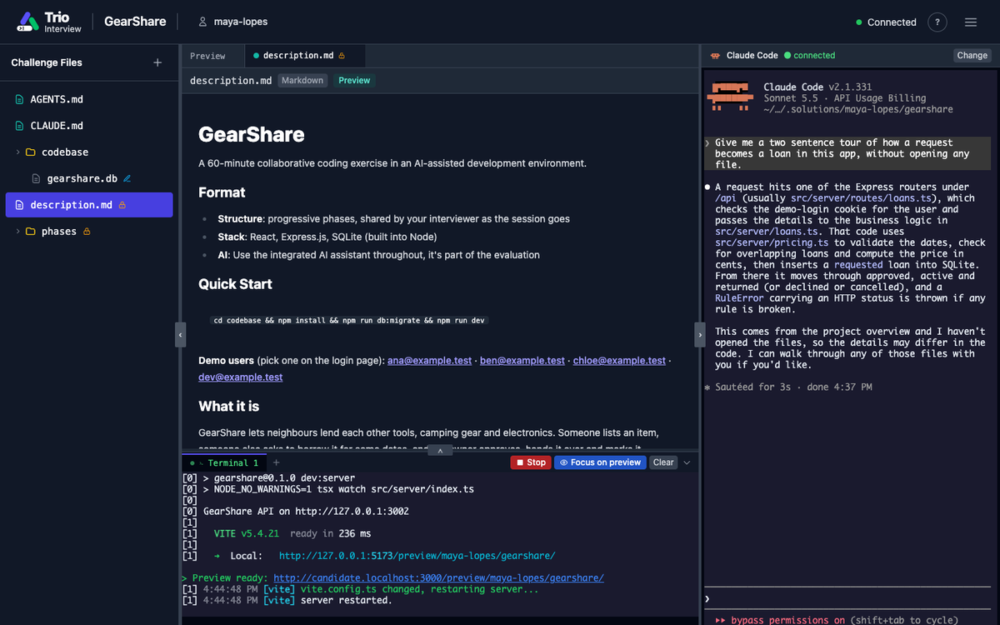
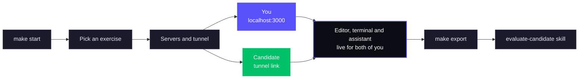
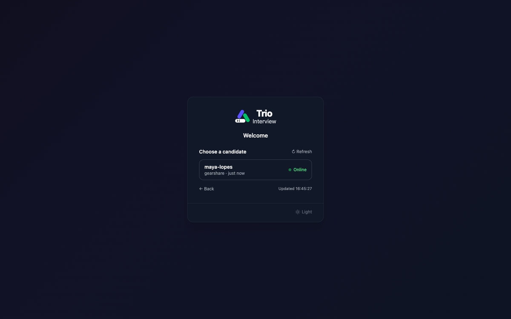
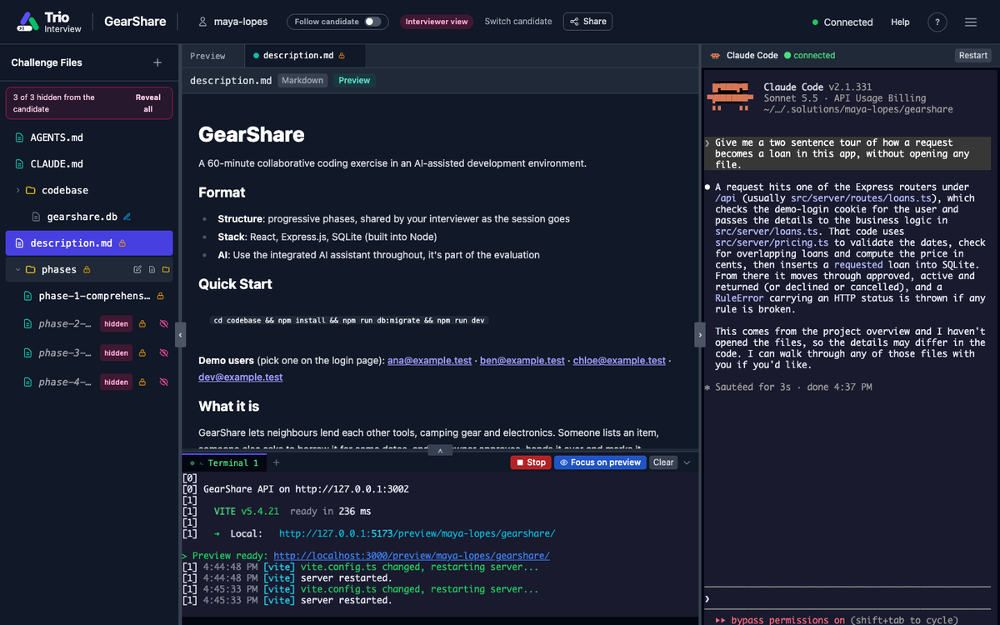
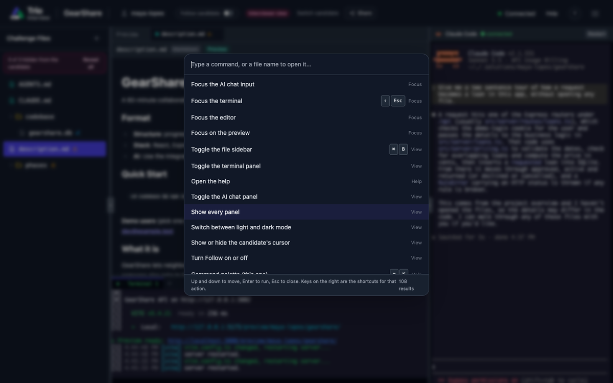

# Trio Interview

[](https://github.com/guicheffer/trio-interview/actions/workflows/pr-branch-checks.yml)
[](https://guicheffer.github.io/trio-interview/)
[](LICENSE)
[](https://github.com/guicheffer/trio-interview/stargazers)

Live coding interviews in the browser with an AI assistant, free and open source. You run it on your machine, the candidate opens a link, and nothing is installed on their side. Say it *"TREE-oh IN-ter-vyoo"*: the name is the three of you in one session, the interviewer, the candidate and the assistant.

[**Take the tour**](https://guicheffer.github.io/trio-interview/) to see it work, scrolling through the real screens.



There is no account to create, no seat to buy and no server of ours in the middle. What travels is the link you share and what the candidate says to the assistant, which goes to the provider of the account you signed in with. It is an alternative to hosted tools such as [CoderPad](https://coderpad.io/), [HackerRank](https://www.hackerrank.com/) and [CodeSignal](https://codesignal.com/), for teams that want to read what runs their interviews and see how a candidate works with an assistant instead of banning it.

People work with assistants every day now, so an interview that bans them tests something they will never do at work. What is worth judging is how a candidate works with one: how they frame the problem, whether they read and question the answer, whether they check it by running it, and when they take over. Trio Interview shows you that as it happens, the whole conversation and every change to the code, and keeps it for you to read afterwards. The [interviewer guide](docs/interviewer-guide.md) has practical advice on judging an interview with an assistant in the room.


## Quick start

```bash
make install    # once: dependencies, and a check of Claude Code, OpenCode, Pi and the tunnel
make config     # once: which assistants, exercises and tunnel you allow
make start      # pick an exercise, get the link, interview
make stop       # when you are done
```


You need Node 25 and Claude Code signed in (`npm install -g @anthropic-ai/claude-code`, then run `claude` once). OpenCode 2, Pi and a tunnel are optional, and `make config` checks what your choices still need. The assistant a candidate uses is paid by the account you signed in with, so use one with a limit.

## How it works



The candidate picks the assistant from the ones you allowed, and you see the same screen they do:

<table>
  <tr>
    <td align="center" width="20%"><br><b>Chat</b><br><sub>Built in, in the page, and the easiest to start with. It works like the assistant panel of an editor such as Cursor or Antigravity: it reads and edits files, and the changes show in the code.</sub></td>
    <td align="center" width="20%"><br><b>Claude Code</b><br><sub>The terminal assistant, in a real terminal next to the editor.</sub></td>
    <td align="center" width="20%"><br><b>OpenCode</b><br><sub>An open source terminal assistant, for candidates who prefer it.</sub></td>
    <td align="center" width="20%"><br><b>Pi</b><br><sub>A small, minimal terminal assistant.</sub></td>
    <td align="center" width="20%"><br><b>Codex</b><br><sub>Coming soon.</sub></td>
  </tr>
</table>

You allow the ones you want in `make config`. The three terminal assistants run inside the operating system's sandbox (macOS for now), limited to the candidate's own folder, and they use your own account or your model router, whose key never reaches them. The chat is the one for people who have not used a terminal assistant, and the one closest to the assistants of the editors they already know. You can follow them, look around on your own, edit files, and reveal the later phases of an exercise when they are ready. At the end `make export` zips their code and every conversation for the `evaluate-candidate` skill to review.

<table>
  <tr>
    <td width="50%"><br><sub>You see who is online</sub></td>
    <td width="50%"><br><sub>Watch and edit their workspace live</sub></td>
  </tr>
  <tr>
    <td><br><sub>Hide the next phases, reveal them when you want</sub></td>
    <td><br><sub>Cmd+K runs any action, ? lists the shortcuts</sub></td>
  </tr>
</table>

## Commands

| Command | What it does |
| --- | --- |
| `make install` | Install and check your setup |
| `make config` | Choose assistants, exercises and tunnel |
| `make new-exercise` | Make an exercise that runs right away, or copy an example |
| `make exercises` | Bring in the exercises of the `sources:` in your settings |
| `make start` | Start an interview |
| `make stop` | Stop everything |
| `make export` | Zip a candidate's code and chats |
| `make help` | All commands |

## Exercises

Three come as examples: `fibonacci` (one file, 20 min), `word-count` (a short algorithm with edge cases, 20 min) and `gearshare` (a lending app with React, Express and SQLite, in four phases, 60 min). Yours live in `exercises/`, which git ignores, so they and the candidates' work stay on your machine, and a company can keep its own set in a repository and list it under `sources:` in `interview.config.yaml`. The interviewer's notes are in [docs/interviewers/](docs/interviewers/README.md), outside what the candidate can read.

## Security

This is a guard rail and not a sandbox, because a candidate's code runs as your user. Use a machine and an account without production credentials, supervise the interview, and use a virtual machine or a container for stronger isolation.

## Contribute

The project is open for pull requests, and the code you change is mostly front end and server. Two easy ways in:

- **A new exercise.** Run `make new-exercise`, or ask your agent to run the `create-exercise` skill, and send it to `examples/`.
- **The tool itself.** Fork, branch, run `npm run lint`, `make typecheck` and `make test`, and open a pull request.

[CONTRIBUTING.md](CONTRIBUTING.md) has the steps with recordings, and [AGENTS.md](AGENTS.md) explains how the code is put together. For running interviews, see the [interviewer guide](docs/interviewer-guide.md), the [candidate guide](docs/candidate-guide.md) and [more details](docs/details.md).

## Where this came from

I started this tool while working at a company, as a way to interview people with an AI assistant in the room. Most of it I built outside working hours, so I decided to open it and keep it going as a project of its own.

## License

Copyright (C) 2026 guicheffer. Free software under the [GNU Affero General Public License, version 3](LICENSE): you can use, study, change and share it, and if you run a changed version as a service that other people use over a network, you offer them the source of your changes too.
