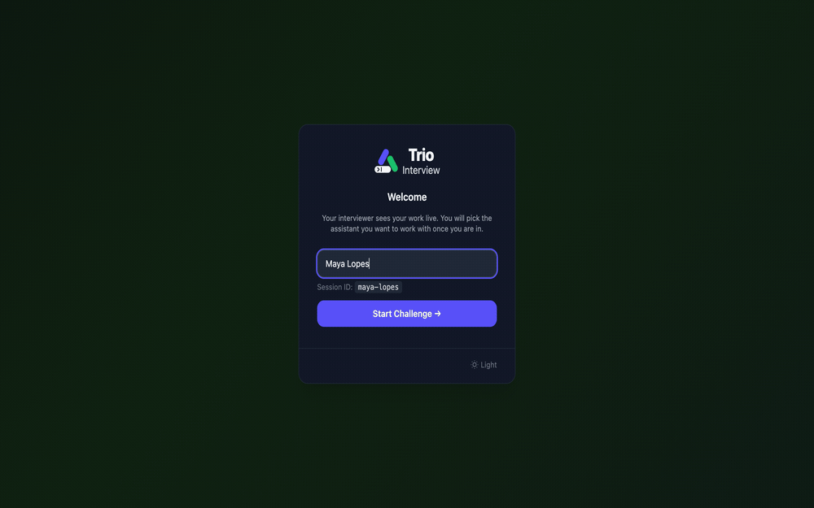
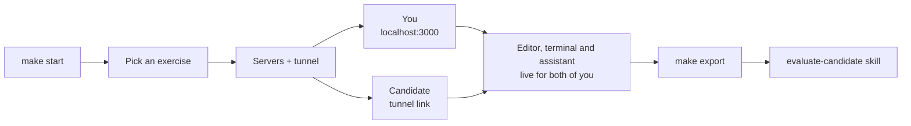
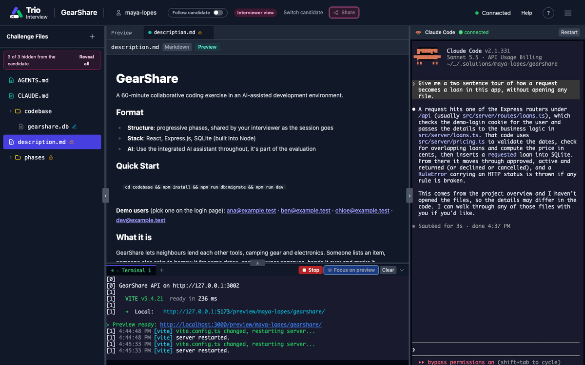

# Trio Interview

Live coding interviews in the browser, with an AI assistant, free and open source. You run it on your machine, the candidate opens a link, and nothing is installed on their side. Say it "TREE-oh IN-ter-vyoo": the name is the three of you in one session, the interviewer, the candidate and the assistant.


A short tour, with a running replica of the workspace, is at [guicheffer.github.io/trio-interview](https://guicheffer.github.io/trio-interview/).

There is no account to create, no seat to buy and no server of ours in the middle, because everything runs on your machine and the only thing that leaves it is the link you share. It is an alternative to hosted tools such as [CoderPad](https://coderpad.io/), [HackerRank](https://www.hackerrank.com/) and [CodeSignal](https://codesignal.com/), for teams that want to read what runs their interviews, keep their exercises to themselves and see how a candidate works with an assistant instead of banning it.



## Quick start

```bash
make install    # once: dependencies, and a check of Claude Code, OpenCode and the tunnel
make config     # once: which assistants, exercises and tunnel you allow
make start      # pick an exercise, get the link, interview
make stop       # when you are done
```

`make start` prints a link for the candidate with a private part that is new for every interview, so an old link or a guessed address gets nothing.

## How it works



The candidate picks the assistant from what you allowed, either the chat or Claude Code or OpenCode running in a real terminal, and you see the same screen they see, with cursors and typing on both sides. You can follow them or look around, edit files too, hide later phases of the exercise and reveal them when the candidate is ready. At the end `make export` zips their code and every conversation, and the `evaluate-candidate` skill turns it into a review.

<table>
  <tr>
    <td width="50%"><br><sub>You see who is online</sub></td>
    <td width="50%"><br><sub>Watch and edit their workspace live</sub></td>
  </tr>
  <tr>
    <td><br><sub>Hide the next phases, reveal them when you want</sub></td>
    <td><br><sub>Cmd+K runs any action, ? lists the shortcuts</sub></td>
  </tr>
</table>

## What you need

Node 25 (`nvm use` reads `.nvmrc`) and Claude Code signed in (`npm install -g @anthropic-ai/claude-code`, then run `claude` once), because both the chat and the Claude Code terminal run on it. OpenCode 2 is optional (`brew install anomalyco/tap/opencode-v2`, signed in to a provider once), and the version matters because the older install command gives version 1, which is not supported. The assistant a candidate uses is paid for by the account you signed in with, so use one with a limit.

To share the link with someone outside your network you need a tunnel, and `make config` asks which one. With `ngrok` (`brew install ngrok`, a free account, then `ngrok config add-authtoken <token>`, once) the address stays the same and every assistant works. With `cloudflared` (`brew install cloudflared`) there is no account and the address is new each time, but the chat does not get its live answers through it, so the candidate should pick Claude Code or OpenCode. `make config` checks what your choice still needs from you.

## Commands

| Command | What it does |
| --- | --- |
| `make install` | Install and check your setup (once) |
| `make config` | Choose assistants, exercises and tunnel (`make config CHECK=1` only reports) |
| `make start` | Start an interview (`make start LOG=1` for full logs) |
| `make stop` | Stop everything |
| `make export` | Zip a candidate's code and chats |
| `make delete` | Delete a candidate and their exercise folder (asks twice) |
| `make help` | All commands |

## Try it once before a real interview

Do a full dry run on the machine and network you will use, which takes about ten minutes. Run `make start`, pick GearShare and open the **Dry run (candidate)** link it prints, enter a name like `test-candidate`, click **Run** in the terminal and ask the assistant something. Then open `http://localhost:3000`, click **I'm an interviewer**, pick the candidate and check that you see what they do, turn **Follow** on and off, and reveal the next phase. To check the tunnel too, open the candidate link in a private window or on your phone. Run `make stop` afterwards, because the link of a test stops working and the real interview gets a new one.

## Exercises

| Exercise | What it is | Time |
| --- | --- | --- |
| `fibonacci` | One file and no app, a warm up | 20 min |
| `gearshare` (in `examples/`) | A neighbourhood lending app with React, Express and SQLite, in four phases: read the code, fix three bugs, add a feature, review it together | 60 min |

`make config` copies an example into `exercises/` when you say yes. The interviewer's notes for each one are in [docs/interviewers/](docs/interviewers/README.md), outside the folder the candidate can read. To write your own, ask your agent to run the `create-exercise` skill and review what it writes, and [CONTRIBUTING.md](CONTRIBUTING.md) shows how.

## Security

Everything listens on loopback and the tunnel is the only way in, every interview has its own link with a private part, the candidate's role is decided on the server, and file access stays inside the candidate's folder. The candidate's code does run as your user, so this is a guard rail and not a sandbox: use a machine and an account without production credentials, supervise the interview, and for stronger isolation use a virtual machine or a container.

## More

[docs/interviewer-guide.md](docs/interviewer-guide.md) is for people running interviews, [docs/candidate-guide.md](docs/candidate-guide.md) is what to send candidates, [docs/details.md](docs/details.md) covers sharing, hiding files, exporting and troubleshooting, and [AGENTS.md](AGENTS.md) explains the code. To help, see [CONTRIBUTING.md](CONTRIBUTING.md).

## Where this came from

I started this tool while working at a company, as a way to interview people with an AI assistant in the room. Most of it, though, I built outside working hours, so I decided to open it and keep it going as a project of its own, free for anyone to use and improve.

## License

Copyright (C) 2026 guicheffer. Trio Interview is free software under the [GNU Affero General Public License, version 3](LICENSE), so you can use, study, change and share it, and if you run a changed version as a service that other people use over a network, the license asks you to offer them the source of your changes too.
